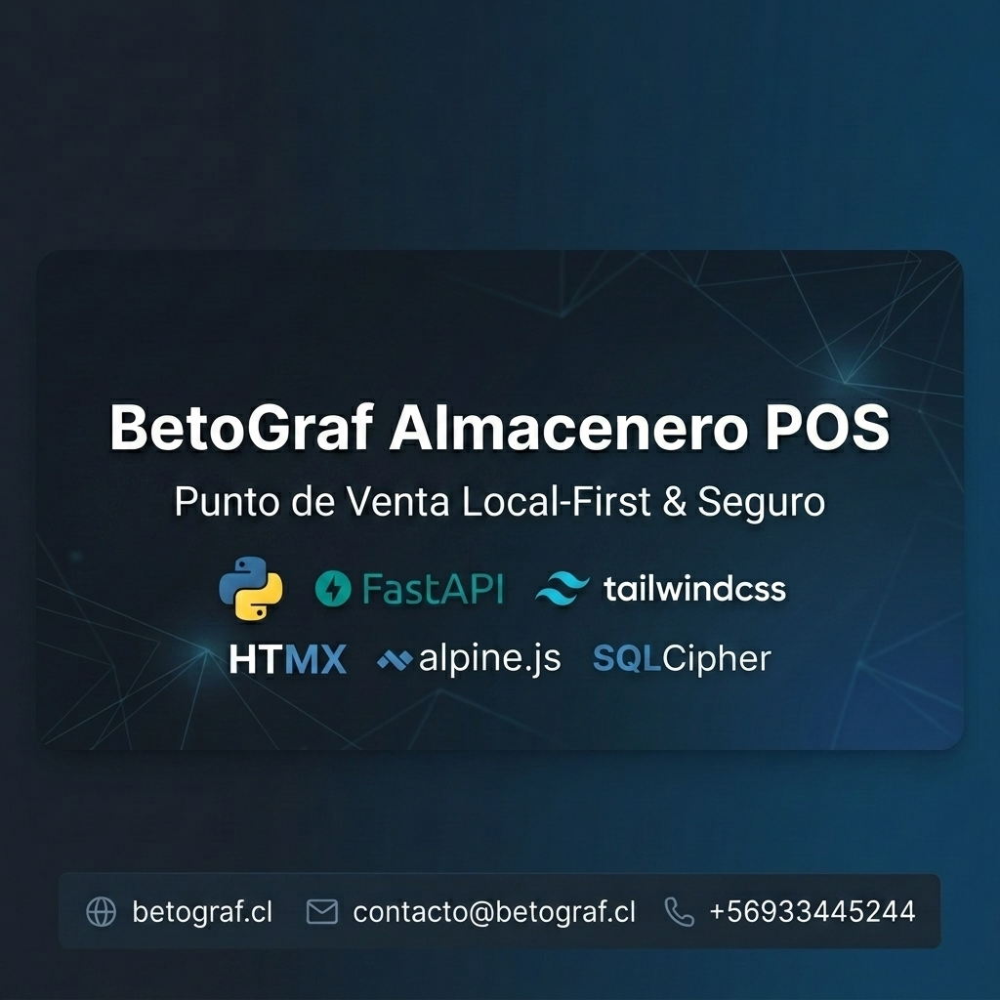

# BetoGraf Almacenero POS — Versión Oficial 2.3.9.14 Enterprise

  

   
  
  ### **El Punto de Venta (POS) Profesional, Blindado y Offline-First para Comercios en Chile**
  
  *Una solución local de alto rendimiento diseñada para maximizar la velocidad de atención (<25 ms), liquidar impuestos automáticamente (F29/SII), operar en red Multi-Caja LAN, gestionar inventario WMS y mantener tu negocio cobrando incluso sin conexión a internet.*

  

    
    
    
    
    
    
    
    
  

  

    <b>¿Cansado de sistemas lentos en la nube que se pegan cuando tienes fila en el local o cuando se cae internet?</b> 
    <b>BetoGraf Almacenero</b> corre 100% local en tu computador. No depende de servidores externos para cobrar, tus datos nunca se filtran, responde en menos de 25 milisegundos y cuenta con certificación digital Authenticode SHA-256 de Windows para una instalación limpia y sin advertencias.
  

  

    📜 <b><a href="./CERTIFICACION_Y_CALIDAD.md">Lee aquí el Dictamen de Certificación Comercial, Rendimiento y Seguridad v2.3.9.14</a></b> 
    ⚡ <b><a href="./COMPARATIVA_RENDIMIENTO.md">¿Por qué BetoGraf pesa ~51.5 MB mientras otros sistemas superan 1 GB? Lee la comparativa técnica aquí</a></b>
  

---

## 🚀 Descarga Rápida de Instaladores Oficiales (v2.3.9.14 Enterprise)

Selecciona la opción de instalación según tu caso:

  <table style="width: 100%; border-collapse: collapse; border: 1px solid #e2e8f0;">
    <thead>
      <tr style="background-color: #f8fafc;">
        <th align="center" style="padding: 12px; border: 1px solid #e2e8f0; width: 50%;">📦 Instalador Completo Oficial (Equipos Nuevos)</th>
        <th align="center" style="padding: 12px; border: 1px solid #e2e8f0; width: 50%;">⚡ Parche Ligero Acumulativo (Clientes Existentes)</th>
      </tr>
    </thead>
    <tbody>
      <tr>
        <td align="center" style="padding: 20px; border: 1px solid #e2e8f0; vertical-align: top;">
          
            
          <b>BetoGraf_Almacen_Setup_v2.3.9.14.exe</b> 
          <small style="color: #64748b;">Instalador oficial para Windows 10 y 11 (64-bits). Firmado digitalmente con Authenticode SHA-256 para instalación limpia y segura.</small> 
          Tamaño: 51.57 MB (Ultra-Optimizado)
        </td>
        <td align="center" style="padding: 20px; border: 1px solid #e2e8f0; vertical-align: top;">
          
            
          <b>BetoGraf_Almacen_Parche_v2.3.9.14.exe</b> 
          <small style="color: #64748b;">Actualización express in-place para comercios con versión anterior instalada. Conserva datos, inventario, ventas y licencias intactos.</small> 
          Tamaño: 51.57 MB (Actualización Segura)
        </td>
      </tr>
    </tbody>
  </table>

---

## 🌟 Las Grandes Innovaciones de la Versión 2.3.9.14 Enterprise

### 1. 🏢 Arquitectura Multi-Giro (6 Perfiles Oficiales Desacoplados)
El sistema adapta su interfaz, lógica tributaria y módulos operativos según el rubro comercial seleccionado:
1. **Almacén / Minimarket / Botillería:** Venta rápida con código de barras, control FIFO de vencimientos y boleta electrónica DTE 39.
2. **Venta Mayorista / Distribución B2B:** Precios por escala según volumen (`PreciosPorEscala`), bultos/packs, dashboard de márgenes y Top Clientes B2B.
3. **Taller Automotriz / Repuestos & Lubricentro:** Buscador predictivo por vehículo (`Marca -> Modelo -> Año`), códigos OEM cruzados y kilometraje.
4. **Barbería & Salón de Belleza:** Agenda de turnos, servicios y liquidación automática de comisiones a profesionales (50% hook nativo).
5. **PetShop & SPA de Mascotas:** Enfoque 100% bienestar y estética animal (cero contexto clínico), ficha estética de pelaje y bitácora interactiva.
6. **Panadería & Verdulería / Granel:** Balanza digital, códigos PLU y tara automática.
*(⚠️ Nota de Producto: Farmacia y Gastronomía quedan 100% excluidas de la plataforma por definición estratégica).*

### 2. 🔒 Gobernanza Monogiro vs Multi-Giro
- **Planes Monogiro (PRO Mensual y PRO Anual):** El giro comercial queda sellado en base de datos (`business_profile_locked = 1`), asegurando consistencia y especialización operativa.
- **Planes Avanzados (PRO Omnicanal, PRO Personalizado y Master Dev):** Selector multi-giro dinámico libre para cambiar entre rubros en caliente.

### 3. 🌐 Arquitectura de Red Multi-Caja LAN (Maestro / Satélite)
- Permite operar múltiples puestos de venta en la misma red local (Subred 192.168.x.x, Router Gigabit).
- **Roles:** Caja Única Standalone, Caja Principal (Servidor Maestro) y Terminal Satélite (Caja Esclava).
- **Modo Directo:** Consistencia inmediata de stock conectada por cable LAN al servidor maestro.
- **Modo Cola Local Resiliente:** Tolera micro-cortes y fluctuaciones Wi-Fi en cajas esclavas sin detener la venta.
- Diagnóstico en vivo de latencia y socket TCP desde la pantalla de configuración.

### 4. 📦 Inventario Avanzado (WMS Bodega & Kardex)
- **Dashboard WMS:** 4 KPIs neurálgicos (Total Productos Físicos, Quiebres de Stock `<= 0`, Stock Crítico `<= 30%` y Valorización Total de Bodega al Costo PMP en pesos).
- **Kardex Valorizado por Producto:** Historial cronológico de entradas, salidas y ajustes físicos, con exportación directa a Excel `.xlsx`.
- **Ajuste Físico Ágil con Pistola:** Interfaz de alta velocidad para escáner de código de barras con auto-enfoque continuo, cálculo dinámico de discrepancia (Sobrante/Faltante) e impacto en pesos en tiempo real.

### 5. ✂️ Módulo de Liquidación de Comisiones
- Hook automático en agenda (`close_appointment`): Al completar una cita, se autoliquida el 50% al profesional responsable.
- Panel administrativo con 4 KPIs de comisiones, filtros por profesional y liquidación atómica masiva o individual.
- Comprobantes de pago calibrados para ticket térmico de 80mm y hoja A4, más planilla Excel oficial.

### 6. 📊 Dashboard Analítico Mayorista B2B
- Identificación inteligente de operaciones mayoristas (compras de 6+ unidades, activación de precios mayoristas o emisión de factura).
- 5 KPIs: Venta Bruta, Venta Neta, Costo Total PMP, Margen Bruto ($) y Margen Promedio (%).
- Ranking de Top Clientes B2B y rendimiento por producto con exportación contable a Excel `.xlsx`.

### 7. 💳 Integración Hardware TUU SmartPOS (Haulmer)
- Driver Cloud REST API v2 directo (`RemotePayment/v2/Create`).
- Validación de monto mínimo regulatorio ($100 CLP) y sondeo en vivo del estado de la transacción (`Sent`, `Processing`, `Completed`, `Failed`).
- Envío directo del cobro desde el POS al terminal físico del cajero con 1 clic.

### 8. 🔄 Renovación Automática de Licencias & Topbar Beacon
- Baliza reactiva en el topbar que se ilumina preventivamente 5 días antes de la caducidad del serial.
- Modal interactivo de renovación con checkout integrado y sincronización OTA instantánea de vigencia con Supabase.

### 9. 📑 Asistente Tributario F29 e Impuestos SII
- Cálculo automático de IVA Débito, IVA Crédito, Remanente y Retenciones de Honorarios.
- Importación en 1 clic del archivo CSV del Registro de Compras y Ventas (RCV) del SII.
- Balance Tributario de 8 Columnas oficial en Excel para bancos y entidades financieras.
- Emisión de Boleta Electrónica DTE 39 e impresión de Factura A4 DTE 33 con timbre PDF417 legal SII.

---

## 💼 Matriz Comercial de Planes, Valores y Variantes

BetoGraf Almacenero adapta sus facultades y alcance comercial según el plan contratado:

  <table style="width: 100%; border-collapse: collapse; border: 1px solid #e2e8f0; font-size: 13px;">
    <thead>
      <tr style="background-color: #0f172a; color: #ffffff;">
        <th align="left" style="padding: 12px; border: 1px solid #334155;">Plan Comercial</th>
        <th align="center" style="padding: 12px; border: 1px solid #334155;">Inversión / Tarifa</th>
        <th align="center" style="padding: 12px; border: 1px solid #334155;">Modalidad de Giro</th>
        <th align="center" style="padding: 12px; border: 1px solid #334155;">Puestos de Caja</th>
        <th align="left" style="padding: 12px; border: 1px solid #334155;">Capacidades y Módulos Incluidos</th>
      </tr>
    </thead>
    <tbody>
      <tr style="background-color: #f8fafc;">
        <td style="padding: 12px; border: 1px solid #e2e8f0;">
          <b>PRO Mensual</b> 
          <small style="color: #64748b;">Suscripción Flexible</small>
        </td>
        <td align="center" style="padding: 12px; border: 1px solid #e2e8f0;">
          <b>$30.000 CLP</b> / mes 
          3 meses: $85.000 6 meses: $160.000
        </td>
        <td align="center" style="padding: 12px; border: 1px solid #e2e8f0;">
          Monogiro Sellado 
          <small style="color: #64748b;">1 rubro de los 6</small>
        </td>
        <td align="center" style="padding: 12px; border: 1px solid #e2e8f0;">
          <b>1 Caja Local</b> 
          <small style="color: #64748b;">Hasta 5 cambios de hardware</small>
        </td>
        <td style="padding: 12px; border: 1px solid #e2e8f0;">
          • Venta rápida offline-first (&lt;25 ms) 
          • Boleta Electrónica SII (DTE 39) térmica 58/80 mm 
          • Control de stock, inventario y cierre ciego 
          • Asistente F29 e importación RCV del SII 
          • Pasarelas Transbank POS, MP y SumUp 
          • Actualizaciones OTA y soporte continuo
        </td>
      </tr>
      <tr>
        <td style="padding: 12px; border: 1px solid #e2e8f0; background-color: #fffbeb;">
          <b>PRO Anual</b> 
          MÁS POPULAR
        </td>
        <td align="center" style="padding: 12px; border: 1px solid #e2e8f0; background-color: #fffbeb;">
          <b>$280.000 CLP</b> / año 
          Ahorro de $80.000 ($23.333/mes promedio)
        </td>
        <td align="center" style="padding: 12px; border: 1px solid #e2e8f0; background-color: #fffbeb;">
          Monogiro Sellado 
          <small style="color: #64748b;">1 rubro de los 6</small>
        </td>
        <td align="center" style="padding: 12px; border: 1px solid #e2e8f0; background-color: #fffbeb;">
          <b>1 Caja Local</b> 
          <small style="color: #64748b;">Soporte prioritario</small>
        </td>
        <td style="padding: 12px; border: 1px solid #e2e8f0; background-color: #fffbeb;">
          <b>Todo lo incluido en PRO Mensual, más:</b> 
          • Facturación DTE 33 en PDF A4 legal SII 
          • Balance Tributario de 8 Columnas para bancos 
          • Órdenes de compra automáticas por stock crítico 
          • Reportes ejecutivos de margen y ganancia PMP 
          • WMS Bodega con Kardex visual por producto 
          • Módulo de Comisiones y Agenda de Servicios 
          • 6 asistencias técnicas anuales prioritarias
        </td>
      </tr>
      <tr style="background-color: #f0fdf4;">
        <td style="padding: 12px; border: 1px solid #e2e8f0;">
          <b>PRO Omnicanal</b> 
          RECOMENDADO B2B
        </td>
        <td align="center" style="padding: 12px; border: 1px solid #e2e8f0;">
          <b>$490.000 CLP</b> / año 
          Comercio Local + Online
        </td>
        <td align="center" style="padding: 12px; border: 1px solid #e2e8f0;">
          Multi-Giro Dinámico 
          <small style="color: #047857;">6 perfiles libres en caliente</small>
        </td>
        <td align="center" style="padding: 12px; border: 1px solid #e2e8f0;">
          <b>Multi-Caja LAN</b> 
          <small style="color: #047857;">Hasta 10 puestos LAN</small>
        </td>
        <td style="padding: 12px; border: 1px solid #e2e8f0;">
          <b>Todo lo de PRO Anual, más:</b> 
          • Red Multi-Caja LAN (Maestro / Satélite) 
          • Módulo Cuentas por Pagar a crédito (🌟 Exclusivo) 
          • Integración WhatsApp Business Cloud API 
          • Bandeja DM de Instagram sincronizada 
          • Webhooks Shopify y WooCommerce 
          • Feed Catálogo XML Meta (Instagram & FB Shop) 
          • Cobros automáticos por links de pago Flow/MP 
          • Soporte VIP continuo
        </td>
      </tr>
      <tr style="background-color: #faf5ff;">
        <td style="padding: 12px; border: 1px solid #e2e8f0;">
          <b>Plan a Medida</b> 
          <small style="color: #6b21a8;">Custom Enterprise</small>
        </td>
        <td align="center" style="padding: 12px; border: 1px solid #e2e8f0;">
          <b>Desde $750.000 CLP</b> 
          Cotización Directa
        </td>
        <td align="center" style="padding: 12px; border: 1px solid #e2e8f0;">
          A Medida Total 
          <small style="color: #7e22ce;">Perfiles a pedido</small>
        </td>
        <td align="center" style="padding: 12px; border: 1px solid #e2e8f0;">
          <b>Ilimitado</b> 
          <small style="color: #6b21a8;">Topología dedicada</small>
        </td>
        <td style="padding: 12px; border: 1px solid #e2e8f0;">
          • Desarrollo de módulos custom en rama aislada <code>personalizacion</code> 
          • Adaptación de hardware, balanzas industriales o etiquetadoras 
          • Integración a medida con ERPs o proveedores mayoristas 
          • Flujos específicos de facturación y despacho logístico 
          • Asesoría directa y levantamiento técnico por Staff Engineer
        </td>
      </tr>
    </tbody>
  </table>

> 🎁 *Todas las descargas nuevas incluyen **20 días de prueba gratuita (TRIAL)** con acceso completo a las funciones operativas del sistema sin compromiso.*

---

## ⚡ Comparativa Real: BetoGraf POS vs Otros Sistemas del Mercado

| Característica Clave | Sistemas Web en la Nube *(SaaS tradicionales)* | Software Antiguo en Electron *(Pesados y lentos)* | BetoGraf Almacenero POS *(Arquitectura Local de Alto Rendimiento)* |
| :--- | :---: | :---: | :---: |
| **¿Funciona si se corta internet?** | ❌ Se cae y no puedes cobrar | ⚠️ Parcial o con fallas | **✅ 100% Operativo sin internet** |
| **Tiempo de respuesta al cobrar** | 200 ms a 1.5 segundos | 150 ms a 400 ms | **⚡ Menos de 25 milisegundos** |
| **Impresión de boleta térmica** | Bloquea la pantalla mientras imprime | Se congela en horas punta | **🚀 En segundo plano (Cero espera)** |
| **Operación en Red Local (LAN)** | Requiere internet para sincronizar | Configuración compleja | **🌐 Nativa Maestro / Satélite con ping TCP** |
| **Inventario WMS y Ajuste de Stock** | Básico o módulo de pago extra | Lento para lectores de barra | **📦 WMS con Kardex PMP y pistola ágil** |
| **Liquidación de Impuestos F29** | Manual o requiere contador externo | Manual o inexistente | **📑 Automático con importación RCV del SII** |
| **Liquidación de Comisiones** | No disponible | No disponible | **✂️ Automática en turnos y citas de servicios** |
| **Tamaño del instalador** | N/A (Web dependiente) | 500 MB a 1.2 GB | **📦 Solo 51.5 MB (Ultra-Liviano)** |
| **Memoria RAM requerida** | Alto consumo de navegador (+1 GB) | 800 MB a 2 GB | **⚡ ~150 MB (Corre en cualquier PC)** |
| **Seguridad de tus ventas** | En servidores externos de terceros | Poco protegidos | **🔒 Base de datos local cifrada AES-256** |

---

## 🛠️ Guía Rápida de Instalación (Windows 10 y 11)

1. Descarga el instalador oficial [BetoGraf_Almacen_Setup_v2.3.9.14.exe](https://github.com/betorockers/BetoGraf_Almacenero/releases/download/v2.3.9.14/BetoGraf_Almacen_Setup_v2.3.9.14.exe) (o el parche ligero si ya tienes una versión instalada).
2. Ejecuta el archivo descargado.
3. El instalador configurará automáticamente los accesos directos en tu escritorio y menú de inicio, registrando las firmas digitales seguras Authenticode.
4. Abre **BetoGraf Almacén** y comienza a vender inmediatamente.

---

## 📚 Biblioteca de Manuales y Guías Paso a Paso

Consulta los manuales completos en formato Markdown (.md) disponibles en la carpeta [`docs/`](./docs/):

| Manual / Guía | Documento | Lo que aprenderás |
| :--- | :---: | :--- |
| **📖 Manual de Usuario General** | [manual_usuario.md](./docs/manual_usuario.md) | Venta rápida en caja, apertura y cierre ciego, inventario y productos. |
| **📑 Manual de Contabilidad y Asistente F29** | [manual_contabilidad_f29.md](./docs/manual_contabilidad_f29.md) | Cálculo automático de F29, carga de RCV del SII y balance de 8 columnas. |
| **💳 Pasarelas de Pago y Equipos POS** | [Manual_Equipos_POS.md](./docs/Manual_Equipos_POS.md) | Conexión con TUU SmartPOS (Haulmer), Mercado Pago Smart Point, QR y SumUp. |
| **📱 Meta Omnichannel (WhatsApp e Instagram)** | [manual_meta_onboarding.md](./docs/manual_meta_onboarding.md) | Catálogo en redes sociales y recepción de pedidos por mensajería. |
| **🛒 Integración E-Commerce** | [Manual_Integracion_Ecommerce.md](./docs/Manual_Integracion_Ecommerce.md) | Sincronización automática de stock con Shopify y WooCommerce. |
| **💰 Guía de Precios, Costos e Impuestos** | [guia_ingreso_precios.md](./docs/guia_ingreso_precios.md) | Márgenes de ganancia, cálculo de IVA (19%) y precios brutos vs netos. |

---

## 📞 Atención Comercial y Soporte Directo

  <table style="width: 80%; border-collapse: collapse;">
    <tr style="background-color: #f8fafc;">
      <td align="center" style="padding: 15px; border: 1px solid #e2e8f0; width: 50%;">
        🌐 <b>Sitio Web Oficial</b> 
        <a href="https://betograf.cl">betograf.cl</a>
      </td>
      <td align="center" style="padding: 15px; border: 1px solid #e2e8f0; width: 50%;">
        💬 <b>Atención Directa por WhatsApp</b> 
        <a href="https://wa.me/56933445244">+56 9 3344 5244</a>
      </td>
    </tr>
  </table>

   
  BetoGraf Almacenero POS es una marca y desarrollo de BetoGraf. Todos los derechos reservados.

